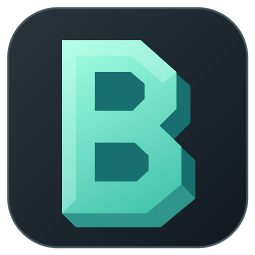

<p align="center"></p>

# Baya 3D

**An open-source, Maya-inspired workspace and keyboard workflow for Blender.**

Baya 3D brings familiar navigation, transform keys, shelves, a Channel Box and smooth mesh preview to Blender. The aim is to help artists move between familiar workflows while keeping Blender's modeling, rendering and animation tools available.

**Status: experimental.** Development currently targets **Blender 5.3.0 Beta**. Keyboard behavior and editor integration are being actively tested. Earlier Blender versions and future beta builds are not yet supported. This repository contains an add-on and optional Windows launcher source; install Blender separately.

## What you can try

- Alt + mouse navigation and Q/W/E/R/T selection and transform tools.
- Modeling, sculpting, rigging, animation, rendering and FX shelves.
- Transform channels, modifier inputs/history and display collections in the sidebar.
- 1/2/3 smooth mesh preview and 4/5/6/7 viewport display modes.
- Component selection shortcuts, creation/selection pies and a Space hotbox approximation.
- A charcoal theme and optional Baya 3D launcher with original artwork.

See the [shortcut guide](docs/shortcuts.md), [known limits](docs/limitations.md) and [roadmap](ROADMAP.md). Exact Maya behavior is a development goal, not a current compatibility guarantee. Blender's engine, data model and `.blend` file format remain in use.

## Install

Save your work and close other Blender windows using the same preferences before installing. The installer updates the current Blender version's add-on, keymap and preferences. It creates a timestamped backup first. It does **not** save or replace `startup.blend` or a scene file.

From a cloned checkout on Windows:

```powershell
.\scripts\install.ps1 -BlenderExe "C:\path\to\Blender\blender.exe"
```

The script can also find `BLENDER_EXE`, `blender` on `PATH`, or a Blender executable beside the repository. Use `-Theme` to apply the optional charcoal theme.

On other platforms, run Blender's bundled Python installer directly:

```sh
blender --background --python scripts/install.py
# Optional theme:
blender --background --python scripts/install.py -- --theme
```

Restart Blender after installation. Viewport keys work when the pointer is over the 3D viewport and a text field is not being edited. The add-on lives under its existing module name, `blender_maya`; its displayed name is **Baya 3D**.

See [installation and recovery](docs/install.md) for exact behavior, manual enablement, development and backups. The optional [Windows launcher](branding/README.md) can be built from source; no engine binaries are distributed here.

## Help build it

Contributors are welcome: Blender Python developers, technical artists, modelers, riggers, animators, UI designers and testers. Small, well-tested improvements are especially useful. Start with [CONTRIBUTING.md](CONTRIBUTING.md), [help wanted](docs/help-wanted.md) and the [roadmap](ROADMAP.md), or open an issue describing a reproducible problem.

Current priorities are reliable keyboard behavior across modes, tool/manipulator parity, held hotbox behavior, and practical rigging and animation workflows. A useful report includes the Blender build, operating system, active keymap, mode, focused editor, expected action and actual result. Never upload personal scenes or preferences unless you have reviewed and intentionally chosen to share them.

## Development checks

```sh
python -m compileall -q blender_maya scripts tests
python scripts/build_addon.py
blender --background --factory-startup --python tests/blender_smoke.py
```

The first two checks require only Python. The Blender smoke test runs in memory and does not save preferences or scenes. Interactive mouse/keyboard behavior still needs the [manual test checklist](docs/testing.md).

## License and attribution

Project code and original Baya artwork are available under **GPL-3.0-or-later**, unless a file says otherwise. See [LICENSE](LICENSE) and [THIRD_PARTY_NOTICES.md](THIRD_PARTY_NOTICES.md). The keymap uses Blender's installed Industry Compatible keymap at runtime; it is not bundled in this repository.

Baya 3D is an independent community project. It is not affiliated with, sponsored by, or endorsed by Autodesk or the Blender Foundation. Autodesk and Maya are trademarks of their respective owners. No Autodesk software, manuals or branding assets are included.
